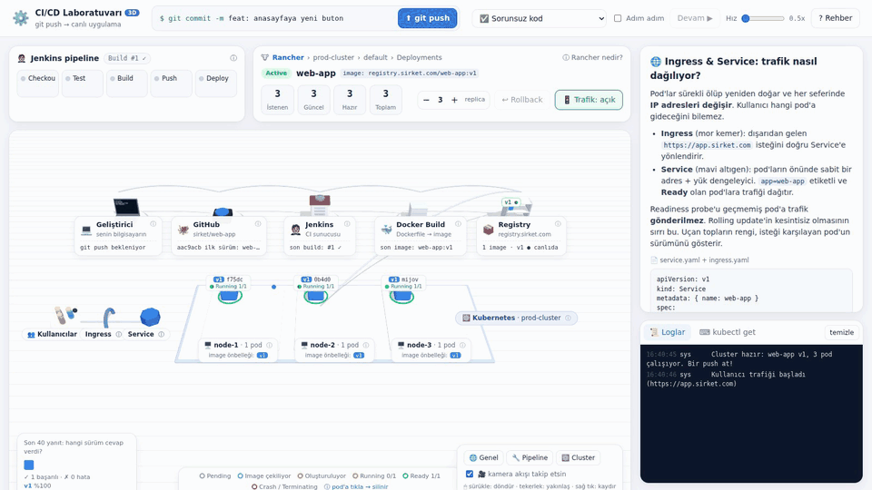

# CI/CD Laboratuvarı

`git push` → GitHub → Jenkins → Docker → Registry → Kubernetes (Rancher) akışını adım adım, 3D ve interaktif olarak gösteren bir simülasyon.

### 🚀 Canlı demo: **[emrullahccelik.github.io/cicd-lab](https://emrullahccelik.github.io/cicd-lab/)**

[](https://emrullahccelik.github.io/cicd-lab/)

<sub>👆 Görsele tıklayınca canlı demo açılır. Kurulum gerekmez, tarayıcıda çalışır.</sub>

## Neler denenebilir?

| Ne yap | Ne öğrenirsin |
|---|---|
| **git push** | Bütün boru hattı: webhook, Jenkins stage'leri, Docker katmanları, registry, rolling update |
| **Adım adım** + **Devam** (veya Boşluk tuşu) | Her adımda durup açıklamayı okumak |
| **🚦 Trafik** | Service'in trafiği Ready pod'lara dağıtması, güncelleme sırasında kesinti olmaması |
| **Pod küpüne tıkla** | Self-healing: ReplicaSet silinen pod'un yerine yenisini açar |
| **replica − / +** | Ölçekleme, scheduler, node'ların image çekmesi (pull) |
| **❌ Test kırılıyor** | CI'ın güvenlik ağı: bozuk kod canlıya çıkamaz |
| **💥 Uygulama çöküyor** | CrashLoopBackOff, `maxUnavailable: 0` sayesinde eski sürüm çalışmaya devam eder, ardından **Rollback** |
| **⌨ kubectl get** sekmesi | Aynı durumun gerçek `kubectl` çıktısında nasıl göründüğü |

3D sahnedeki etiketlere ve **ⓘ** simgelerine tıklayınca o parçanın açıklaması, örnek kodu ve YAML'ı sağ panelde açılır.

**Sahne kontrolleri:** sürükle → döndür, tekerlek → yakınlaş, sağ tık → kaydır. Sağ alttaki butonlarla Genel / Pipeline / Cluster görünümüne geçilir. "Kamera akışı takip etsin" açıkken kamera push sırasında kendisi gezer.

## Kendi bilgisayarında çalıştırma

Projede derleme ya da `npm install` yok. Sadece dosyaları bir web sunucusuyla servis etmek yeterli. Three.js (r170) `vendor/three/` klasöründe projeye dahil, internet bağlantısı gerekmez.

> ⚠️ `index.html` dosyasına **çift tıklamak çalışmaz.** Three.js modül olarak yüklendiği için tarayıcılar `file://` üzerinden açılan sayfada bunu engeller. Aşağıdaki yollardan biriyle bir web sunucusu başlat.

Önce projeyi indir:

```bash
git clone https://github.com/emrullahccelik/cicd-lab.git
cd cicd-lab
```

### 🪟 Windows

PowerShell'de, proje klasöründeyken:

```powershell
python -m http.server 8765
```

`python` bulunamazsa `py -m http.server 8765` dene ya da Python'u [python.org](https://www.python.org/downloads/) veya Microsoft Store'dan kur.

### 🍎 macOS

Terminal'de, proje klasöründeyken:

```bash
python3 -m http.server 8765
```

`python3` macOS'ta genelde hazır gelir. Yoksa ilk çalıştırmada sistem Xcode Command Line Tools'u kurmayı önerir.

### 🐧 Linux

Terminal'de, proje klasöründeyken:

```bash
python3 -m http.server 8765
```

Sunucu çalışırken tarayıcıda **http://localhost:8765** adresini aç. Durdurmak için terminalde `Ctrl + C`.

### Python yerine

Hangi işletim sisteminde olursan ol, şunlar da aynı işi görür:

- **Node.js** kuruluysa: `npx serve` (açılan adresi terminal yazar)
- **VS Code** kullanıyorsan: [Live Server](https://marketplace.visualstudio.com/items?itemName=ritwickdey.LiveServer) eklentisini kur, `index.html`'e sağ tıklayıp **Open with Live Server** de.

## Dosyalar

- `index.html`: sayfa iskeleti
- `style.css`: görünüm (açık tema)
- `app.js`: simülasyon (pipeline, Deployment/ReplicaSet controller'ları, pod yaşam döngüsü, trafik) ve Türkçe açıklamalar
- `scene.js`: Three.js 3D sahnesi (istasyonlar, borular, Docker katmanları, registry rafı, cluster, pod küpleri, trafik topları)
- `vendor/three/`: Three.js kütüphanesi (MIT lisansı)
- `docs/`: README görselleri

İlk 2D sürüm [`b8d4c7a`](https://github.com/emrullahccelik/cicd-lab/tree/b8d4c7a) commit'inde duruyor.
